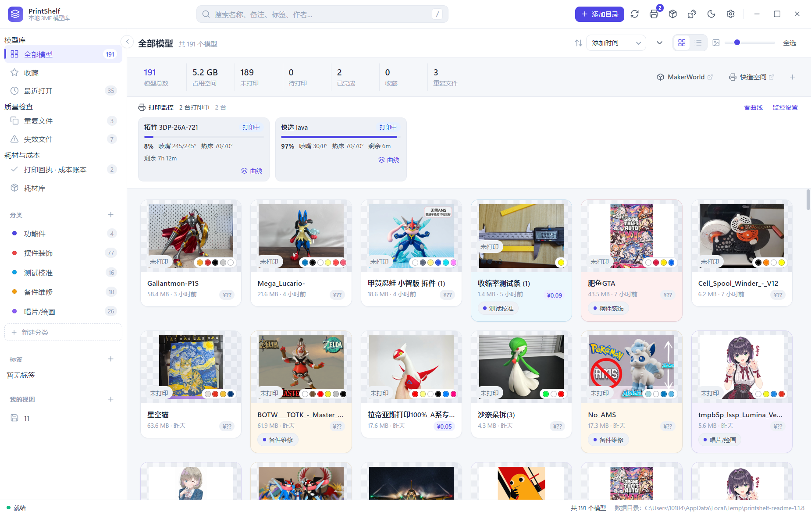

> English | [简体中文](README.md)

# PrintShelf · 3MF Model Manager

**Turn the 3MF files already on your PC into a searchable, visual model library — then send them straight to your slicer.**

Windows 10/11 · Local-first · No account required · Core features work offline · [MIT License](LICENSE)



## What it does

Your `.3mf` files are scattered across Downloads, external drives and the desktop, with names only you can decode.
PrintShelf scans them into one visual library: thumbnails, categories, search, and a one-click hand-off to Bambu Studio, OrcaSlicer or another slicer.

No upload, no sign-up. The index, thumbnails, notes and settings stay on your machine; original 3MF files are never rewritten.

## What you get

- **See everything at a glance**: thumbnail grid / list, search, filters and sorting for libraries of any size.
- **Drag to organize**: drop a card onto a category or tag in the sidebar.
- **Duplicates and variants stay out of the way**: byte-identical files merge into one record; recolored, scaled or re-exported versions are grouped by identical thumbnails.
- **Open in your slicer**: configure Bambu Studio, OrcaSlicer or Snapmaker Orca and open a model right from its card.
- **Damaged files have a home**: retry parsing, attempt a repair, quarantine, or send to the Recycle Bin instead of leaving a dead placeholder.
- **Print receipts and costs**: track status, time, material, cost, receipts and temperature history; successful prints can deduct filament inventory automatically.
- **Find models faster**: natural-language search (“green box printed last month”) and search by image.
- **LAN device center**: discover Bambu, Snapmaker, Anycubic, Creality, FlashForge, OctoPrint and Moonraker printers; monitor progress, set temperatures and send G-code.
- **Optional extras**: model health check / optimization and Bambu-to-Snapmaker U1 3MF conversion, all local.

## Download

Get the latest build from [Releases](https://github.com/tjh01a/PrintShelf-3MF-3D-Printing-Model-Manager/releases/latest):

- **Installer**: `3MF-Model-Manager-1.2.2-setup.exe` — run it and follow the wizard.
- **Portable**: `3MF-Model-Manager-1.2.2-portable.zip` — unzip to a permanent folder and run `3MF模型管理器.exe`.

> Release asset names are ASCII for GitHub compatibility. The app name, window title and shortcut remain Chinese.

## First launch

1. **Choose a folder containing your 3MF files** (required). A dedicated model folder is recommended; avoid scanning a whole drive.
2. **Start scanning**. The first scan takes longer; later scans are incremental.
3. **Enter the library**. Slicer and default filament are optional; you can configure them later.

The onboarding wizard has a **中 / EN** switch in the top-right corner. Choosing English makes the rest of the wizard and the whole app English; after the reload it resumes on the same step.

## Where your data lives

By default: `data/` next to the app. If installed in a read-only location such as `Program Files`, it falls back to the user data directory.
To back up or move to another PC, copy the whole `data/` folder. Uninstalling the app does not delete your model files or index.

## Run from source

Windows 10/11 + Node.js 20+:

```bash
npm install
npm start
```

Full self-test:

```bash
npm run selftest
```

Build:

```bash
npm run setup:rebuild
```

## More

- Implementation guide: [docs/09-实现说明书.md](docs/09-实现说明书.md)
- First launch and distribution: [docs/16-首次启动向导与分发.md](docs/16-首次启动向导与分发.md)
- i18n and English release plan: [docs/21-国际化与英文发布计划书.md](docs/21-国际化与英文发布计划书.md)

## License

[MIT](LICENSE)
