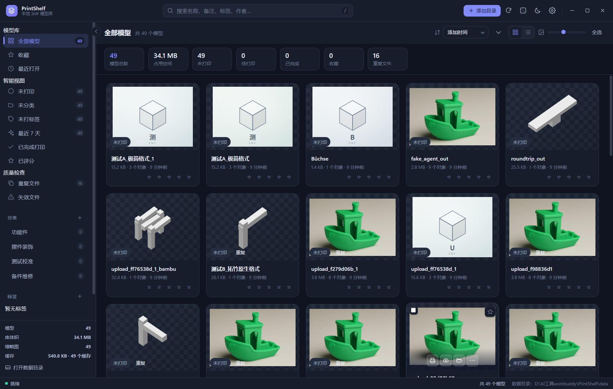
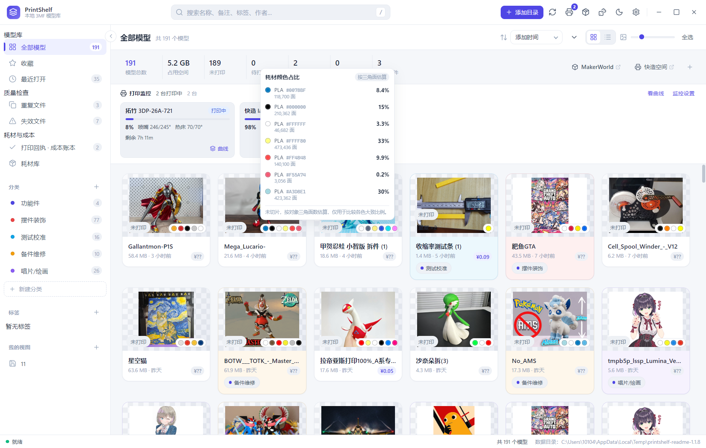

全部都由workbuddy ai工具开发，参与开发的大模型有：Hy4、Hy4flash、deepseekv4flash。

> 语言 / Language：简体中文 | [English](README.en.md)

# 3MF 模型管理器

一个装在 Windows 上的**本地模型库**。把你电脑里的 `.3mf` 文件扫进来，像刷图库一样找模型、分类、预览，选中后一键送进切片软件，准备打印。

不用注册；核心功能不需要联网、也不上传文件（可选拓竹云端通道需要登录）。索引、分类、标签、备注、缩略图和配置都放在本机 `data/` 目录，原始 3MF 不会被改写。





## 1.2.1 开发中（尚未打包发布）

- **损坏文件隔离区**：解析失败的 3MF 不再只能在列表里当占位卡。侧栏「损坏文件」里可以重试解析、按压缩包结构尝试修复（原文件不动，修好后再问你要不要替换，替换会把原文件备份成 `.broken.bak`）、移入隔离目录，或直接进回收站 / 移出索引。
- **重复文件合并成「副本」**：每组选一条主记录，其余降为副本——不再占列表、不重复计数，备注和打印记录都保留；详情页能看到副本并随时解除。合并时可以选择只改记录，或连文件一起进回收站。
- **同款变体**：同一个模型改颜色、放大缩小、换个姿势重新导出，文件名和哈希都会变，但模型自带的缩略图通常不变。软件在后台按缩略图文件比对，把缩略图完全相同的文件归到「同款变体」，靠谱的可以直接合并。
- **删了就是删了**：在文件夹里删掉 3MF 后，默认直接在模型库里移除这条记录，不再出现在「失效文件」，总数也跟着减。想保留备注、分类和打印记录等以后重新定位，可在设置 → 扫描里关掉这个开关（关掉后移动硬盘离线也不怕）；开启时移动/重命名文件会被当成删旧建新，人工字段不会跟着走。
- **耗材管理**：侧栏「耗材管理」分两个 tab——**耗材库存**记录你真正拥有的卷（类型、颜色、剩余克数、整卷克数、元/kg、备用卷），打印成功会按回执自动扣料；**耗材库**则是市面耗材的选购/比价参考，放图片、品牌、价格和购买链接。库存低了标「偏低」并每天提醒一次，还能称重、加备用卷、逐条撤销、导出采购清单 CSV。侧栏不再单列「失效文件」。
- **自然语言搜索**：搜索框直接说人话，比如「上个月打印过的绿色收纳盒」「大于 50MB 的双色模型」，回车后条件变成可逐项移除的筛选标签；认不出的词仍按普通关键字。解析全在本机，不联网，也可以关掉。
- **以图搜图**：搜索框旁多了「以图搜图」，选一张图就按缩略图相似度列出模型，点结果直接开详情。索引在扫描后后台补算，不用手动等。
- **周报 / 成就 / 护照**：打印回执页右上角有「本周周报」，点开就是本周成功率、用料、成本、7 天柱状图和 Top 5；设置 → 数据管理里能看 11 条成就进度，以及导出含许可与商用判断的模型护照 CSV；详情页新增「模型护照」小节。
- 另外补齐了 `.badge.warn / .danger / .badge-ok` 的语义底色，特殊视图里的状态徽标不再是裸文字。

### 1.2.0 更新

- **中英双语**：顶栏一键切换，或到「设置 → 外观 → 界面语言」选择；后续新功能也走同一套翻译框架。
- **MakerWorld 双站**：英文界面默认打开国际站、中文界面默认打开中国站；也可以在设置里固定站点。两站模型 ID 不通用，目标站找不到时会自动回退到另一站并提示。
- **英文版关键词**：英文界面新建库使用英文分类（Functional Parts / Figures & Decor / Test & Calibration / Spare Parts & Repair）和英文社区常用关键词，不再用中文词直译。
- **英文版耗材库**：首次使用不再内置三条通用耗材，由用户自己添加。

### 1.1.8 更新

- 卡片更清爽：不显示五星评分和“xx 个对象”，信息行支持换行显示完整内容。
- 色板悬停可看每个颜色的占比；有切片克数按克数算，没有则按对象三角面数估算。
- MakerWorld 链接默认自动跳国内站；3MF 描述里没写链接的，也会用 `DesignModelId` 反查作品页。
- 首次启动自带 3 条通用耗材及图片，同名耗材不会重复添加。
- 修复开发版任务栏图标；发布包排除调试用 `PrintShelf-dev.exe`。

---

## 怎么用

### 最简单：下载现成程序

到本仓库 **Releases** 页面下载：

- **安装版**：`3MF-Model-Manager-1.2.0-setup.exe`，双击按向导安装，自动建快捷方式。
- **绿色版**：`3MF-Model-Manager-1.2.0-portable.zip`，解压到固定文件夹后双击 `3MF模型管理器.exe` 就能用。

> 附件名只能用英文（GitHub 限制），软件名、窗口标题和快捷方式都是中文「3MF模型管理器」。版本号随 `package.json` 的 `version` 变化；1.0.x 时期的产物属历史遗留。

首次打开只要三步：**选模型文件夹 → 选扫描深度 → 开始扫描**。以后再打开，直接进库。

### 从源码运行

需要 Windows 10/11 + Node.js 20+：

```bash
npm install
npm start
```

项目目录在本地仍叫 `PrintShelf`，这是历史包名，不影响使用。

---

## 这个工具能做什么

- **模型一眼找到**：缩略图墙、列表视图、搜索、筛选、排序，文件再多也不乱。
- **拖一下就分类**：把卡片拖到左侧分类或标签上，松手就归类。
- **一键打开切片软件**：Bambu Studio、OrcaSlicer、快造 Orca 都可以；也可以每次换一个。
- **重复文件不刷屏**：内容相同的模型只显示一张卡，点进详情再切换副本；重复视图里可选主记录合并成「副本」，也可以整组进回收站。
- **坏文件有地方管**：解析失败的 3MF 会出现在「损坏文件」视图，可重试、尝试修复、移入隔离目录或进回收站，不会只留一张占位卡没人管。
- **同款变体**：按缩略图文件（不看文件名和网格形状）把改色、缩放、换姿势导出的同一模型归到一起，确认后可以合并。
- **来源链接自动认出来**：MakerWorld 等网页链接会显示在卡片上，有链接的地球按钮是绿色；3MF 描述里没写链接时，会用项目里的 `DesignModelId` 反查作品页。点开 MakerWorld 链接会按界面语言/站点设置选择国内站或国际站，目标站没有对应模型时自动回退并提示。
- **能记住打印状态**：标已打印、记打印次数、写备注、在详情里打星评分，下次打开还在。
- **能算大概成本**：中文界面首次启动自带 3 条通用耗材（遇果PETG / R3D透明 / 大简PETGHF）和图片，英文界面首次使用为空库；已有同名耗材不会重复添加；也可以手动加耗材、设默认耗材，按模型重量估算价格。耗材图片直接拖 png/jpg 进来，导入时可以先裁切、改大小。卡片右下角色板鼠标移上去会展开各颜色占比；没有切片克数时按对象三角面数估算。
- **打印完自动记账**：回执按「几月几日 时:分 打印完成 / 打印失败」显示，机器、耗时、用料、成本都能回看。会自动关联到模型库里的模型——同一个模型分几次打印、名字后面多了 `_plate_2` 或 `(3)` 也认得出来；连错了点「更换关联」自己改。
- **设备扫描与管理**：发现/添加打印机，单台移除、批量移除失效设备、一键整理设备列表。
- **打印监控温度曲线**：查看喷嘴 / 热床温度与打印进度曲线，回看历史记录。
- **机内摄像头**：支持快造 U1 等机内摄像头的实时画面。
- **自动分类与全部跳过**：预设词库自动归类；没匹配上的模型可「全部跳过」，不再反复提醒。
- **可选的模型体检 / 优化**：看看模型有没有碎面、细长三角，需要时生成一个优化后的新文件，原文件不动。
- **可选的快造 U1 转换**：把拓竹 3MF 转成快造能正确识别的工程，不上传、不联网。

---

## 常见问题

**需要联网吗？**
核心功能不需要联网：模型文件、缩略图、备注都只在本机处理。可选的拓竹云端通道需要登录，用于云端设备 / 任务；不登录也能用全部本地功能。

**需要装 Node 吗？**
下载安装包或绿色版不需要。只有从 GitHub 克隆源码自己运行时才需要 Node.js。

**数据放在哪里？怎么备份？**
默认在程序目录下的 `data/`（绿色版就是解压目录里的 `data/`）。安装版如果装在 `Program Files` 等不可写目录，程序会自动回退到系统用户数据目录下的 `data/`（Electron `userData/data`）。也可以设置环境变量 `PRINTSHELF_DATA_DIR` 显式指定。整个 `data/` 拷走就算备份；换电脑时拷回来即可。

**卸载会删我的模型吗？**
不会。卸载只删程序；模型文件本来就没动过，索引和缩略图也可以选择保留。

**SmartScreen 提示「未知发布者」？**
这是没有代码签名的正常提示，点「更多信息 → 仍要运行」即可。

---

## 给开发者

```bash
npm install
npm start
npm run selftest
```

更多细节按需看这些文档：

- `docs/09-实现说明书.md`：功能是怎么实现的
- `docs/16-首次启动向导与分发.md`：打包与分发
- `docs/18-交互与UIUX白皮书.md`：交互与视觉约定
- `docs/21-国际化与英文发布计划书.md`：双语架构与关键词策略

---

## License

[MIT](LICENSE)
